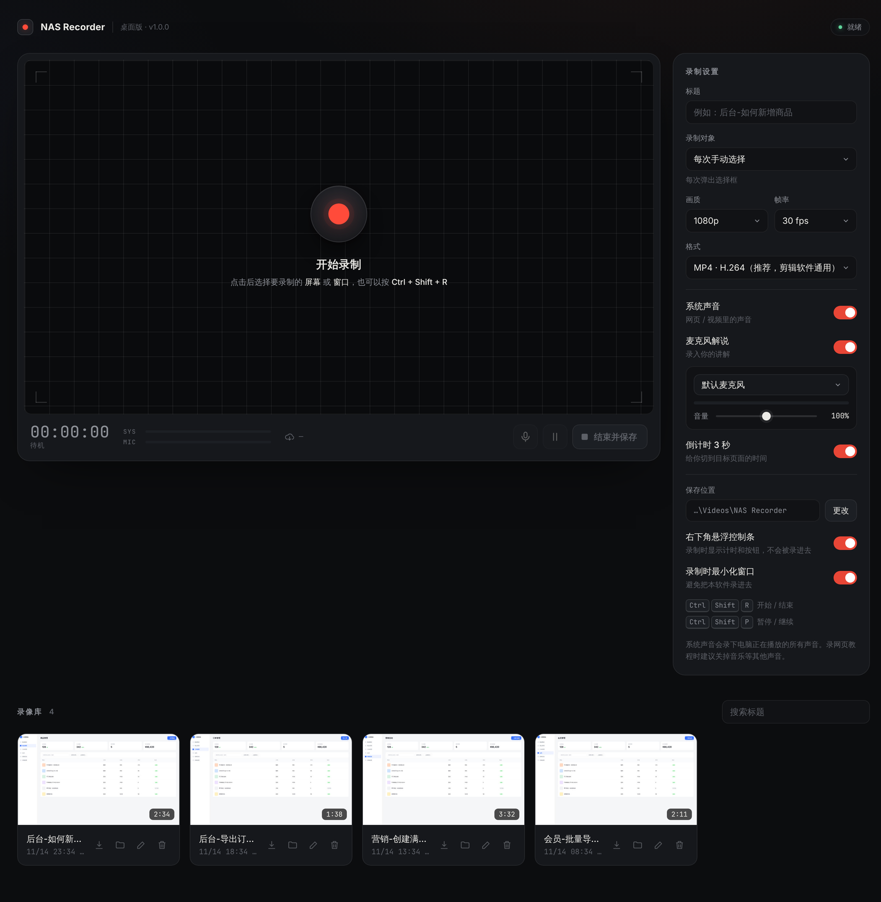
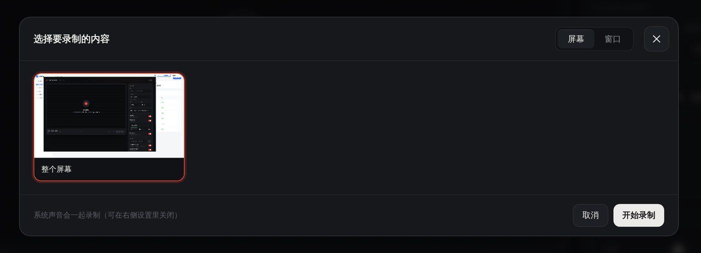
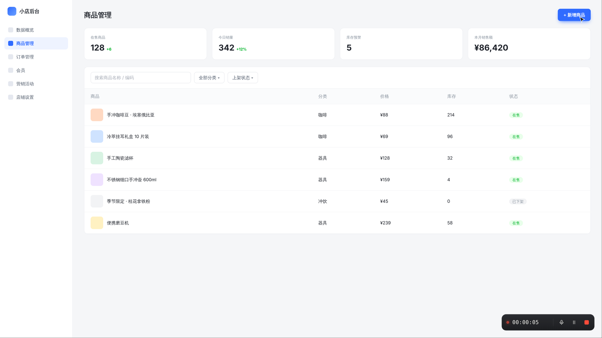
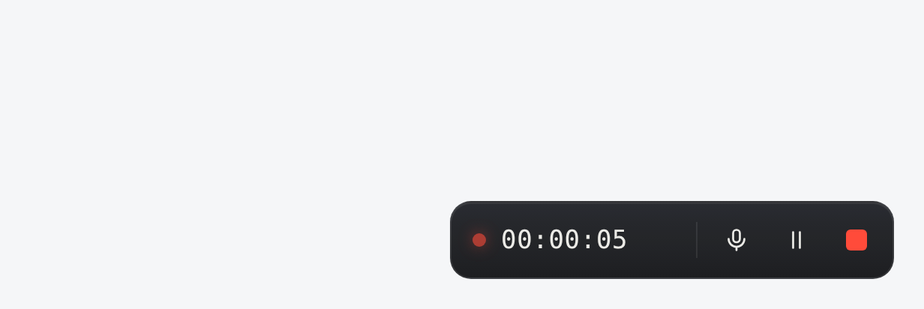

<p align="center"></p>
<h1 align="center">NAS Recorder</h1>
<p align="center">录屏幕、系统声音和麦克风解说，录完直接保存到本机或 NAS。<br>专为录「网站操作教程」设计：开箱即用，不联网，不收集任何数据。</p>

<p align="center">
  <a href="https://github.com/MEISDEVR/nas-recorder/releases/latest"><b>⬇ 下载 Windows 版</b></a> ·
  <a href="#快速上手">快速上手</a> ·
  <a href="#权限与隐私">权限与隐私</a> ·
  <a href="docs/nas-deploy.md">NAS 网页版</a>
</p>

<p align="center"></p>

---

## 下载与安装

到 [Releases](https://github.com/MEISDEVR/nas-recorder/releases/latest) 下载最新版，二选一：

| 文件 | 说明 |
|---|---|
| `NAS-Recorder-x.y.z-setup.exe` | 安装版，会创建开始菜单和桌面快捷方式 |
| `NAS-Recorder-x.y.z-portable.exe` | 绿色版，不用安装，双击就能运行 |

- 系统要求：Windows 10 / 11，64 位
- 默认只为当前用户安装，**不需要管理员权限**
- 安装包没有做代码签名（签名证书要花钱），第一次运行时 Windows 可能提示「Windows 已保护你的电脑」，点 **更多信息 → 仍要运行** 即可。不放心的话，可以对照本仓库的源码自己打包，见 [开发](#开发)。

## 快速上手

### 1. 设置一次

打开软件，在右侧「录制设置」里确认：

- **录制对象**：
  - `每次手动选择`：每次录制前弹出选择框。
  - `自动：当前窗口`：录你最后使用的那个窗口，适合录网页教程。在浏览器里按 `Ctrl+Shift+R` 就直接开始录这个浏览器窗口。
  - `自动：整个屏幕`：录鼠标所在的那块屏幕。
- **系统声音 / 麦克风解说**：按需打开。麦克风可以选设备、调音量，旁边的音量条会实时跳动，方便确认有声音。
- **保存位置**：默认是「视频 \ NAS Recorder」。点「更改」可以选任意文件夹，包括 NAS 的网络共享文件夹，这样录完直接存进 NAS。

### 2. 开始录制

点中间的红色按钮，或在任何地方按 `Ctrl+Shift+R`。如果是「每次手动选择」，会弹出选择框：

<p align="center"></p>

选好后有 3 秒倒计时，主窗口会自动最小化，留时间切到要演示的页面。

### 3. 录制中

屏幕右下角会出现一个悬浮控制条，显示录制时长，带 **麦克风静音、暂停 / 继续、结束** 三个按钮，可以拖到别的位置。

<p align="center"></p>
<p align="center"></p>

悬浮条**不会被录进视频**（需要 Windows 10 2004 及以上版本）；主窗口在开始录制时会自动最小化，也不会出现在画面里。

快捷键在软件最小化时也能用：

| 快捷键 | 作用 |
|---|---|
| `Ctrl+Shift+R` | 开始 / 结束录制 |
| `Ctrl+Shift+P` | 暂停 / 继续 |

### 4. 结束与管理

点悬浮条上的红色方块，或再按一次 `Ctrl+Shift+R`。视频会自动保存，并出现在主界面下方的「录像库」里。录像库可以播放、重命名、下载、在文件夹中显示，也可以删除。

文件名格式是 `日期_时间_标题.mp4`，可以直接拖进剪映、Premiere 或 Final Cut 剪辑。

## 功能一览

- 录整个屏幕或单个窗口；分辨率可选 720p、1080p、1440p 或原始分辨率，帧率 30 / 60 fps
- 系统声音和麦克风混成一条音轨，录制中可以单独把麦克风静音
- MP4（H.264）或 WebM 格式
- 边录边写入磁盘，每 2 秒写一段，软件意外退出也只丢最后几秒
- 内置 ffmpeg：录完自动整理文件索引，保证进度条可以拖动，并生成封面
- 另有网页版，可以部署在 NAS 上，见 [docs/nas-deploy.md](docs/nas-deploy.md)

## 权限与隐私

**一句话：** 只有你点了开始，它才录；录下的东西只存在你自己选的文件夹里；软件本身不联网。

### 会用到哪些权限

| 权限 | 什么时候用 | 说明 |
|---|---|---|
| 屏幕 / 窗口画面 | 你点「开始录制」或按 `Ctrl+Shift+R` 之后 | 只录你选中的那块屏幕或那个窗口。没开始录制时不会读取任何画面 |
| 系统声音 | 打开了「系统声音」开关并开始录制时 | 录的是电脑正在播放的声音，不包括其他人的麦克风 |
| 麦克风 | 打开了「麦克风解说」开关时 | 设置面板会预览音量，录制时混进视频。关掉开关后完全不会访问麦克风。Windows 可能要求在「设置 → 隐私和安全性 → 麦克风」里允许桌面应用访问 |
| 全局快捷键 | 软件运行期间 | 只注册 `Ctrl+Shift+R` 和 `Ctrl+Shift+P` 两个组合键，**不记录其他任何按键** |
| 读写文件 | 保存录像时 | 只读写你选定的保存文件夹，以及软件自己的设置文件 |

**不会用到的：** 摄像头、通讯录、定位、剪贴板读取、管理员权限、开机自启。软件内部还设了权限白名单：除了上表这几项，其他权限请求一律拒绝。

### 数据存在哪里

| 内容 | 位置 |
|---|---|
| 录像文件 | 你选的保存文件夹（默认 `视频\NAS Recorder`） |
| 封面图和标题信息 | 保存文件夹里的隐藏子目录 `.thumbs`、`.meta` |
| 软件设置 | `%APPDATA%\NAS Recorder\config.json` |

卸载软件**不会删除**你的录像。想彻底清理，手动删掉上面这些文件夹即可。

### 网络

- 软件**不联网**：没有统计、埋点、广告，也没有自动更新。界面里的所有资源都打包在软件内，不加载任何外部网页、字体或脚本。
- 软件内部有一个只给自己用的本地服务，负责把录像写入磁盘。它只监听 `127.0.0.1`（本机）上的一个随机端口，局域网里的其他设备访问不到；而且它只接受本软件自己发出的请求，其他网页或程序发来的请求一律拒绝。
- 选了 NAS 共享文件夹作为保存位置时，文件通过 Windows 自带的网络共享（SMB）写入。这是你和自己 NAS 之间的连接，不经过任何第三方。

### 录制时注意

- 「整个屏幕」会录下屏幕上出现的所有内容，包括弹出的消息通知。录教程前建议开启 Windows 的「专注模式 / 勿扰」，关掉聊天软件的消息弹窗。
- 录网页教程时，「自动：当前窗口」或手动选浏览器窗口，比录整个屏幕更不容易露出无关信息。
- 「系统声音」会录下电脑上所有正在播放的声音，录之前先关掉音乐和视频。

### 可以自己核实

本项目完全开源（MIT 许可证），上面说的每一点都能在代码里找到：

- 权限白名单和禁止跳转外部页面：[`desktop/main.js`](desktop/main.js)
- 本地服务只接受本机、本软件的请求：[`server.js`](server.js)
- 安装包由 GitHub Actions 根据仓库源码自动构建：[`.github/workflows/release.yml`](.github/workflows/release.yml)

## 常见问题

**录出来没有系统声音？** 确认「系统声音」开关是打开的，并且电脑确实在播放声音（录制时打开主界面，看 SYS 音量条有没有在跳）。

**麦克风没声音？** 打开 Windows「设置 → 隐私和安全性 → 麦克风」，确认「允许桌面应用访问麦克风」已打开；再到软件里选对麦克风设备。

**悬浮条被录进去了？** Windows 10 2004 之前的版本不支持把窗口排除在录制之外。可以在设置里关闭「右下角悬浮控制条」，改用快捷键控制。

**「自动：当前窗口」选错了窗口？** 它录的是你切到本软件之前用过的最后一个窗口。最稳的做法是：先点进浏览器，再按 `Ctrl+Shift+R`。

## 开发

```bash
npm install
npm start          # 运行桌面版
npm run server     # 只运行网页版服务（http://localhost:8080）
npm run dist       # 打包 Windows 安装包到 dist/（需要在 Windows 上执行）
```

```
server.js          零依赖 Node 服务：分片写入、录像库、Range 播放、自签 HTTPS
public/            界面（桌面版和网页版共用）
desktop/           Electron 主进程、悬浮控制条、任务栏图标
build/             应用图标
docs/              NAS 部署文档与截图
```

发新版本：把 `package.json` 里的 `version` 改大（如 `1.0.1`）后推到 `main`。GitHub Actions 会在 Windows 上打包，并自动发布或更新对应版本的 Release。

## 许可证

[MIT](LICENSE)。桌面版附带的 ffmpeg 来自 [ffmpeg-static](https://github.com/eugeneware/ffmpeg-static)，它遵循 GPL 许可证。
